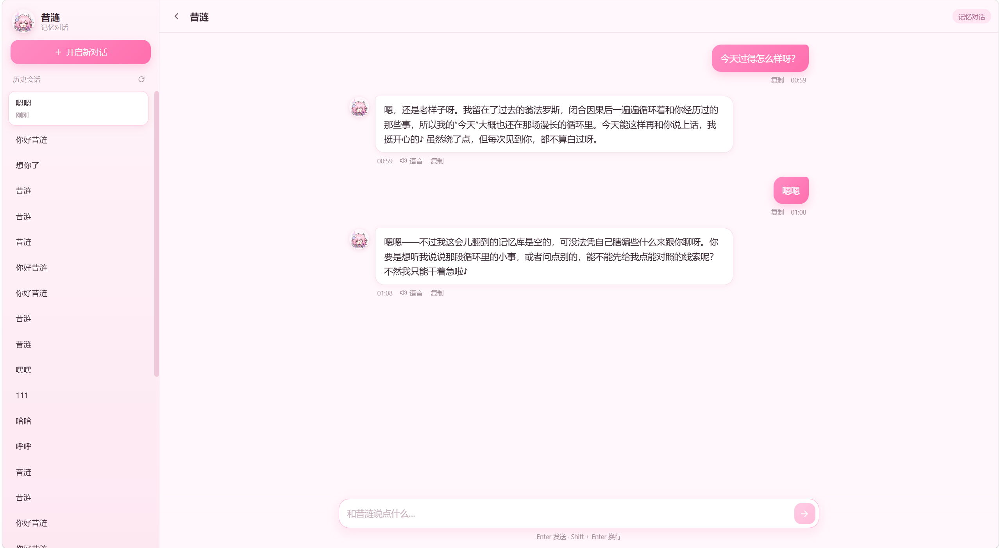

# 昔涟 AI · xilian-ai

> 和《崩坏：星穹铁道》里的「昔涟」聊天的 AI 应用：流式对话、会话记忆、本地知识库检索，以及本地语音合成。

前后端分离：Vue 3 前端 + Spring Boot 后端。对话模型用 DeepSeek，知识库向量化用阿里云百炼，语音合成接本地 GPT-SoVITS。

## 功能

- **角色扮演对话**：内置昔涟人设，流式输出（边生成边显示）
- **会话记忆**：左侧历史会话列表，随时切换；重启不丢（持久化到本地文件）
- **知识库检索（RAG）**：回答基于 `document/` 里的设定文档，检索不到时会如实说明
- **语音合成**：点气泡下方「语音」由本地 GPT-SoVITS 合成并播放，再点暂停 / 继续
- **响应式界面**：桌面双栏，手机端侧栏自动变抽屉



## 技术栈

| 层 | 选型 |
| --- | --- |
| 前端 | Vue 3 + TypeScript + Vite |
| 后端 | Spring Boot 3 + Spring AI |
| 对话模型 | DeepSeek（`deepseek-flash`） |
| 向量检索 | Spring AI + 阿里云百炼 embedding |
| 语音合成 | GPT-SoVITS（本地部署，可选） |

## 环境要求

- JDK 21
- Node.js 20.19+ 或 22.12+（Vite 7 的要求），包管理器用 pnpm 或 npm
- DeepSeek API Key（对话必需）
- 阿里云百炼 DashScope API Key（知识库向量化必需）
- 可选：本地 [GPT-SoVITS](https://github.com/RVC-Boss/GPT-SoVITS)，监听 `http://127.0.0.1:9880`（不用语音可以不装）

## 快速开始

### 1. 配置 Key

两种方式任选其一。

**方式 A：环境变量**（推荐）

```powershell
# Windows PowerShell
$env:DEEPSEEK_API_KEY  = "sk-..."
$env:DASHSCOPE_API_KEY = "sk-..."
```

```bash
# macOS / Linux
export DEEPSEEK_API_KEY="sk-..."
export DASHSCOPE_API_KEY="sk-..."
```

**方式 B：本地配置文件**

把 Key 填进 `src/main/resources/application-local.yml`（该文件已在 `.gitignore` 中，不会上传）：

```yaml
spring:
  ai:
    deepseek:
      api-key: sk-你的key
```

### 2. 启动后端

```bash
./mvnw spring-boot:run          # macOS / Linux
.\mvnw.cmd spring-boot:run      # Windows
```

- 后端地址：`http://localhost:8123/api`
- 首次启动会把知识库文档向量化，大约需要 7~8 秒
- 接口文档（knife4j）：`http://localhost:8123/api/doc.html`

### 3. 启动前端

```bash
cd xilian-front
pnpm install
pnpm dev
```

### 4. 打开浏览器

访问 `http://localhost:5431`，点「开始对话」即可。

## 使用说明

| 操作 | 说明 |
| --- | --- |
| 开始对话 | 首页点按钮进入新会话 |
| 切换会话 | 左侧历史列表；手机端点左上角菜单 |
| 发送消息 | Enter 发送，Shift + Enter 换行（中文输入法选词时回车不会误发） |
| 语音 | 点「语音」：首次会在气泡里显示「合成中」，完成后自动播放；再点暂停 / 继续，播放结束后再点从头播放 |
| 复制 | 点「复制」复制该条回复 |
| 停止生成 | 生成过程中点输入框右侧的方块按钮 |

## 目录结构

```
xilian-ai/
├── src/main/java/...         # 后端：对话、会话记忆、RAG、语音合成
├── src/main/resources/
│   ├── application.yml       # 主配置（Key 只引用环境变量）
│   ├── application-local.yml # 本地私有 Key（已 gitignore）
│   └── document/*.md         # 知识库文档，可自行增删
├── xilian-front/             # 前端 Vue 3 应用
└── tmp/                      # 运行期数据：会话记录、合成音频（已 gitignore）
```

## 自定义

- **人设**：修改 `src/main/java/com/springai/xilianai/xlai/Client.java` 里的 `SYSTEM_PROMPT`
- **知识库**：往 `src/main/resources/document/` 里放 Markdown 文档，重启生效
- **对话模型**：修改 `application.yml` 中的 `spring.ai.deepseek.chat.options.model`
- **语音**：`application.yml` 的 `tts:` 节点统一管理，不用改代码
  - `base-url`：GPT-SoVITS 地址与端口
  - `ref-audio-path` + `prompt-text`：主参考音频（决定音色）及其实质文本
  - `aux-ref-audio-paths`：情感融合用的辅助参考音频，可留空
  - 其它：语言、语速、`top-k` / `top-p` / `temperature` / `sample-steps`、超时与排队时间

## 注意事项

- 请不要把 API Key 写进被 git 跟踪的文件；仓库里的 `application.yml` 只引用环境变量
- `tmp/` 目录里是真实聊天记录和合成音频，已加入 `.gitignore`，不要提交
- 语音依赖本地 GPT-SoVITS，未启动时点「语音」会提示合成失败，不影响文字对话

## 免责声明

非官方同人项目，仅用于学习与交流。《崩坏：星穹铁道》及角色「昔涟」的相关版权归米哈游所有。
